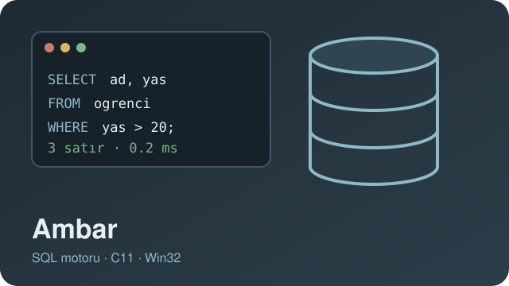
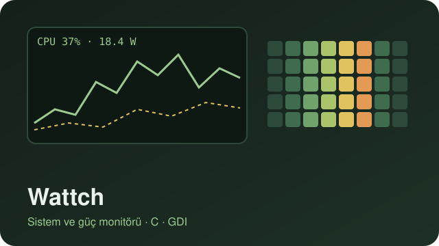
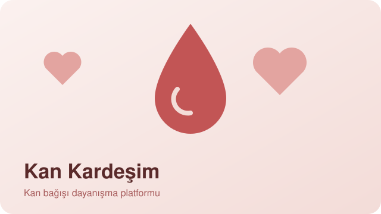
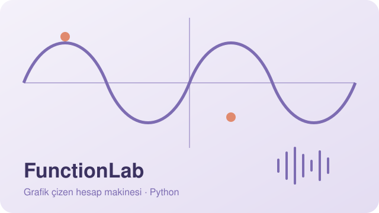
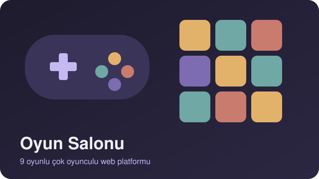
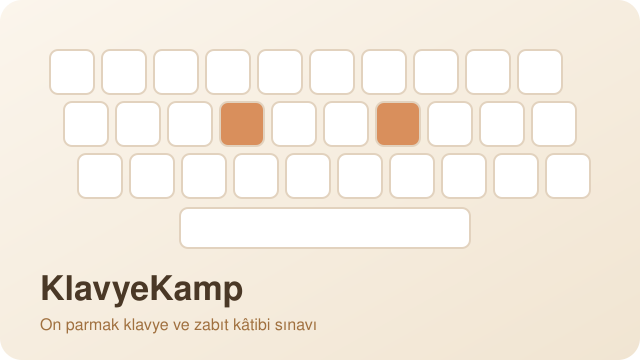

 

   

 

Bilgisayar Mühendisliği öğrencisiyim ve PIAV Studio'da geliştirici olarak çalışıyorum. C ve Win32 ile bağımlılıksız Windows araçları, Python ile masaüstü uygulamaları, tarayıcıda çalışan oyunlar ve web uygulamaları yazıyorum.

 

## Projeler

<table>
<tr>
<td width="50%" valign="top">

<h3>Ambar</h3>
C11 ile sıfırdan yazdığım küçük bir SQL veritabanı motoru. Yanında sorguları çalıştırıp tabloları görebileceğin yerel bir Win32 arayüzü (Ambar Studio) var. Hiçbir bağımlılığı yok.
  C11 · Win32 · <a href="https://github.com/Yusuf-Tarlak/Ambar">GitHub</a>
</td>
<td width="50%" valign="top">

<h3>Wattch</h3>
Saf C ile yazılmış hafif bir Windows sistem ve güç monitörü. CPU grafikleri, yük ısı haritası, enerji maliyeti hesabı ve ağ, disk, GPU takibi.
  C · Win32 · GDI · <a href="https://github.com/Yusuf-Tarlak/Wattch">GitHub</a>
</td>
</tr>
<tr>
<td width="50%" valign="top">

<h3>Kan Kardeşim</h3>
Acil kan ihtiyacı olanlarla gönüllü bağışçıları buluşturan sosyal sorumluluk platformu. Elif Feyza Güneş'le birlikte yürütüyoruz.
  Vite · Firebase · <a href="https://kankardesim.org.tr/#home">kankardesim.org.tr</a>
</td>
<td width="50%" valign="top">

<h3>FunctionLab</h3>
Fonksiyon çizen masaüstü grafik hesap makinesi. Kökleri ve ekstremumları buluyor, grafikleri sese çeviriyor. İfadeleri güvenli bir AST değerlendiricisiyle hesaplıyor.
  Python · Tkinter · <a href="https://github.com/Yusuf-Tarlak/FunctionLab">GitHub</a>
</td>
</tr>
<tr>
<td width="50%" valign="top">

<h3>Oyun Salonu</h3>
PIAV çatısı altında geliştirdiğim çok oyunculu web oyun platformu. 9 oyun, arkadaş sistemi ve tarayıcıdan tarayıcıya P2P bağlantıyla birlikte oynama.
  JavaScript · Firebase · PeerJS · <a href="https://github.com/Yusuf-Tarlak/Oyun-Salonum">GitHub</a>
</td>
<td width="50%" valign="top">

<h3>KlavyeKamp</h3>
Türkçe on parmak klavye eğitmeni. 160 resmi sınav metniyle hazırlanmış bir zabıt kâtibi sınavı simülatörü de içeriyor.
  Python · Tkinter · <a href="https://github.com/Yusuf-Tarlak/KlavyeKamp">GitHub</a>
</td>
</tr>
</table>

### Diğerleri

- [wholocks](https://github.com/Yusuf-Tarlak/wholocks): Windows'ta bir dosyayı hangi işlemin kilitlediğini bulup istersen kapatan araç (CLI + sürükle bırak arayüz)
- [VoltGuard](https://github.com/Yusuf-Tarlak/VoltGuard): Windows dizüstüleri için çevrimdışı pil izleme ve koruma aracı, 6 dil
- [ShutEye](https://github.com/Yusuf-Tarlak/ShutEye): bilgisayarı seçtiğin saatte kapatan, yeniden başlatan ya da uyutan küçük araç, 12 dil
- [PhasmoSaveEditor](https://github.com/Yusuf-Tarlak/PhasmoSaveEditor): kaybolan Phasmophobia ilerlemesini geri almak için iki dilli kayıt düzenleyici
- [PDF Maker](https://github.com/Yusuf-Tarlak/PDF-maker): tarayıcıda çalışan PDF oluşturma aracı
- [AmiralBatti](https://github.com/Yusuf-Tarlak/AmiralBatti): tarayıcıda amiral battı oyunu

 

## Kullandıklarım

 

<picture>
<source media="(prefers-color-scheme: dark)" srcset="https://raw.githubusercontent.com/Yusuf-Tarlak/Yusuf-Tarlak/output/snake-dark.svg">

</picture>

İş birliği için: piavstudioo@gmail.com

